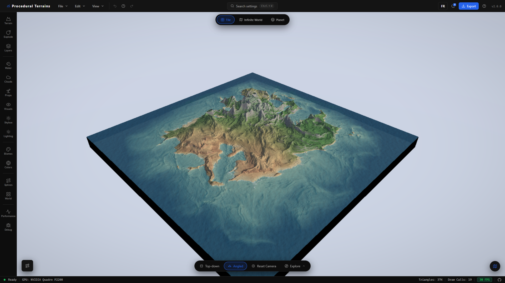
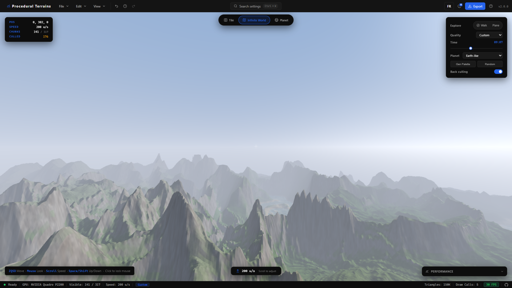
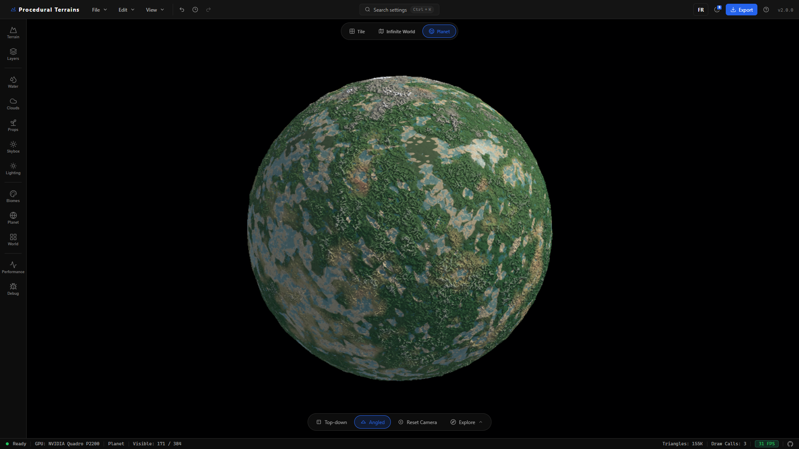
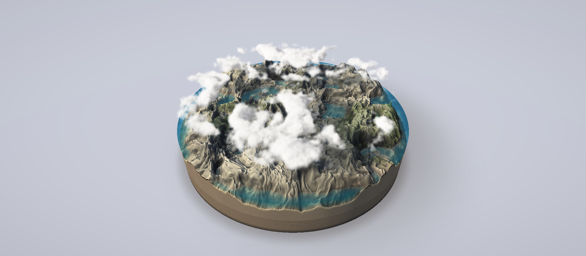

# Procedural Terrains 2.0.0

GPU-driven terrain authoring for the browser: build terrain boards, explore
streamed landscapes, generate planets, and compose miniature dioramas. Native
integrations bring your terrain into Unity and Blender.



Procedural Terrains is a React + Vite + Three.js terrain studio. Height,
normals, and biome colors are evaluated on the GPU, so the live view stays
editable without relying on a baked CPU heightmap.

An experimental [Three.js library](packages/procedural-terrains/README.md) now
extracts finite, infinite, planet and Mini runtimes into a typed ESM package,
with optional water, clouds, material providers, Workers and exports. It uses
your own scene, renderer and loop; see the
[plain Three.js example](examples/three-finite-terrain) and
[migration scope](docs/npm-runtime-migration.md). Build locally with
`npm run build:lib`; this preview is not yet published to npm.

## What’s new in 2.0.0

- **New water looks** — choose Realistic, Volumetric, Cinematic, or the new
  Stylized / Diorama water alongside Legacy. Depending on the mode, water adds
  depth-based absorption, refraction, sky or scene reflections, directional
  waves, and shoreline foam. Tile and Infinite World offer flat-world water
  rendering; Planet uses its spherical ocean shell.
- **Caustics and underwater effects** — animated light patterns bring shallow
  seabeds to life, with controls for strength and depth fading. Tile and
  Infinite World also support camera-submersion fog and tint.
- **Realistic volumetric clouds** — a new cloud renderer adds billowing forms,
  erosion, towering formations, wind shear, sky-lit color, and silver linings.
  Cloud shadows tie the sky to the terrain, with separate shape, lighting,
  animation, and quality controls for Tile, Infinite World, and Planet.
  Legacy rendering remains available.
- **Performance improvements** — cloud rendering supports reduced-resolution
  passes with depth-aware smoothing and ray-step budgets matched to the
  performance preset. GPU quality presets, LOD budgets, energy saving, and the
  optional spatial upscaler help tune the studio to your hardware. Mini Terrain
  also reuses compiled height programs and cached height/climate fields for
  prop placement, with targeted updates when its controls change.
- **Real-world navigation** — automatic city markers, routes between selected
  markers, coordinate formats, and a minimap distance scale make geographic
  terrain easier to explore.
- **French and English** — switch language from the shared header, with a
  saved preference across the landing pages and editor.
- **Mini Terrain** — build a complete diorama from a procedural preset or a
  composed scene such as a cliff cove, islet, or mountain lake. Choose a square
  or circular footprint, layered cutaway walls, terrain and water bevels, and a
  studio backdrop. Relief, water level, vegetation, prop size, and cloud spread
  have dedicated controls; projects preserve the composition and camera views.

Unity `0.4.0-alpha.1` and Blender `0.4.0` integrations, production export
presets, and local-first project storage remain available. Their versions are
independent of the terrain studio's `2.0.0` release.

## Features at a glance

| Capability | Description |
| --- | --- |
| **Tile** | Paint, assemble, and export fixed terrain boards with per-chunk LOD. |
| **Infinite World** | Explore a streamed chunk grid with walk and fly-through controls. |
| **Planet** | Generate a cube-sphere planet with atmosphere, clouds, and orbit controls. |
| **Mini Terrain** | Compose square or circular dioramas with cutaway bases, bounded water, vegetation, and clouds. |
| **Noise Stack** | Compose typed, serializable noise layers that compile to GLSL. |
| **Manual terrain** | Import real-world elevation or shape terrain with brushes. |
| **Water and atmosphere** | Add water, shoreline effects, sky, clouds, fog, and underwater rendering. |
| **Export** | Bake GLB/GLTF, OBJ, color, normal, height, splat, collision, water, and preset data. |

## Explore the studio

### Tile — author, shape, and export

Tile is the workspace for a finite terrain board. Assemble multi-tile layouts,
edit the noise stack, sculpt height, paint biomes and props, and add roads or
rivers. Live surface, water, lighting, and atmosphere settings let you develop
the landscape before exporting meshes, maps, or an engine-ready package.

The opening screenshot shows the Tile editor. Per-chunk LOD keeps the board
editable at different viewing distances; camera presets make it easy to move
between an overview and close terrain work.

### Infinite World — explore a streamed landscape



Infinite World streams terrain chunks around the camera. Walk through the
landscape in first person or explore by plane, with procedural terrain,
biomes, water, sky, and clouds extending beyond a fixed board. View distance,
LOD, and performance settings control the balance between reach and detail.

### Planet — build a complete world



Planet wraps procedural terrain around a cube-sphere, with a spherical ocean,
atmosphere, volumetric clouds, and orbit controls. Start with a planet preset,
then adjust its terrain and visual style for anything from a habitable world
to a more unusual landscape. Planet has its own rendering constraints: water
uses a spherical shell, and flat-world underwater post-processing is disabled.

### Several ways to create terrain

**Procedural** templates and a typed Noise Stack let you build seeded terrain
with live parameters. **Nodes** provides a graph-based authoring workflow.
**Manual Terrain** provides shaping and painting tools, while **Real Terrain**
imports geographic elevation and imagery, with city markers, coordinates,
routes, and a distance scale for navigation.

Across the editor, settings search, camera presets, undo/redo, local project
storage, and production export tools support the full authoring workflow.

### Water, clouds, and atmosphere

The 2.0.0 rendering updates complement the different world modes. Realistic
water adds depth-based color, waves, and shoreline foam; Volumetric adds scene
refraction, while Cinematic Tile water adds displaced geometry and planar
reflections. Animated caustics light shallow seabeds, and Tile and Infinite
World support underwater fog and tint. Stylized water offers the diorama look
in flat worlds; Planet retains its spherical ocean.

Realistic volumetric clouds support formation, erosion, wind shear, lighting,
and silver-lining controls in Tile, Infinite World, and Planet. Cloud shadows,
sky lighting, fog, and the day/night cycle help connect the terrain to its
surroundings. Quality settings let you adjust their rendering cost.

### Mini Terrain — a new diorama workflow



Mini Terrain adds a composed presentation of the finite world: one square or
circular footprint, a layered cutaway base, bounded transparent water, and a
studio backdrop. Start with **Create terrain > Mini Terrain**, choose a
procedural or composed template, then adjust relief, water level, vegetation,
prop size, and cloud spread. The image above is the supplied release capture.

### Engine plugins

| Unity | Blender |
| --- | --- |
|  |  |

Both integrations can import the same renderer-neutral `.ptrterrain` runtime
document and production ZIP exports. They also expose native procedural
generation for their host application. These screenshots are generated from
the local app with Playwright at a 1600 × 900 viewport.

## Quick start

```sh
npm install
npm run dev
```

Open [http://localhost:6061](http://localhost:6061). Vite listens on all
interfaces and prints a LAN URL; if port `6061` is busy, it selects the next
available port.

Create a production build with:

```sh
npm run build
npm run preview
```

### Optional accounts API

The editor is local-first and fully usable without an account. Login and
registration are provided by the independent, self-hostable Node.js/MySQL
service in [`api/`](api/).

```sh
cp .env.example .env
cp api/.env.example api/.env
npm --prefix api install
npm run dev
npm run dev:api
```

Run `npm run migrate:api` once MySQL is configured. Deployment guidance for
Linux, PM2, MySQL, and Nginx is in [`api/README.md`](api/README.md).

## Unity and Blender plugins

The latest archives are available from the app and checked into
[`public/downloads/plugins/`](public/downloads/plugins/).

| Integration | Version | Requirements | Source | Download |
| --- | --- | --- | --- | --- |
| **Unity** | `0.4.0-alpha.1` | Unity `6000.3+` | [`plugins/unity/Packages/com.zyfou.procedural-terrains`](plugins/unity/Packages/com.zyfou.procedural-terrains) | [`Unity ZIP`](public/downloads/plugins/procedural-terrains-unity-0.4.0-alpha.1.zip) |
| **Blender** | `0.4.0` | Blender `5.2+` | [`plugins/blender/procedural_terrains`](plugins/blender/procedural_terrains) | [`Blender ZIP`](public/downloads/plugins/procedural-terrains-blender-0.4.0.zip) |

### Unity workflow

1. Download the Unity ZIP or add the local package through Unity Package Manager.
2. In Procedural Terrains, choose the **Unity Terrain** export preset.
3. In Unity, open **Window > Procedural Terrains > Terrain Importer**.
4. Import the ZIP, or use **Create** to generate seeded terrain natively.

The package creates native `TerrainData`, colliders, connected tile neighbors,
TerrainLayers, and persistent generation recipe assets. See the
[Unity package README](plugins/unity/Packages/com.zyfou.procedural-terrains/README.md)
and [Unity changelog](plugins/unity/Packages/com.zyfou.procedural-terrains/CHANGELOG.md)
for current limitations and release details.

### Blender workflow

1. Download `procedural-terrains-blender-0.4.0.zip`.
2. In Blender 5.2, open **Edit > Preferences > Get Extensions > Install from Disk**.
3. Enable the extension and open **3D View > Sidebar > Terrain**.
4. Use **Create** for native procedural terrain or **Import** for a ZIP/
   `.ptrterrain` export.

The extension creates ordinary editable mesh objects with UVs, source metadata,
shared tile borders, and Blender undo support. Read the
[Blender extension README](plugins/blender/procedural_terrains/README.md) for
installation, coordinate mapping, and performance guidance.

## Choosing a world mode

| Mode | Best for | Details |
| --- | --- | --- |
| **Tile** | Authoring and export | Finite boards, multi-tile layouts, paint brushes, and close-range detail. |
| **Infinite World** | Exploration | Streamed chunks around the camera with first-person walking and plane exploration. |
| **Planet** | Whole-world creation | Cube-sphere terrain with a spherical ocean, atmosphere, clouds, and an orbit camera. |
| **Mini Terrain** | Dioramas and presentation | One finite footprint with a studio stage, cutaway walls, and a bounded water volume. |

Tile also supports square or circular layouts, radial walls, real-world
heightmap import, biome painting, river tools, and procedural prop painting.
Mini Terrain exports can include the water surface and cut faces with a
glass-like glTF material.

## Export pipeline

The Export panel provides quick screenshots and heightmaps, plus production
presets for:

- Unity Terrain
- Unreal Landscape
- Godot Terrain3D
- Blender Scene
- Three.js viewer assets

Full ZIP exports can contain:

- GLB/GLTF or OBJ terrain meshes, with configurable resolution, skirts, and base slabs
- baked color, normal, heightmap, biome splat, and collision maps
- water surface meshes and depth, shoreline, and foam masks
- `terrain.json`, `project.ptrterrain`, and preset metadata for downstream tools

The Production Check validates selections before the GPU bake and flags
high-memory maps or missing water masks.

## Controls

**Tile camera**

- **Left-drag** — pan across the board
- **Right-drag** — orbit
- **Scroll** — zoom
- Bottom toolbar — top-down, angled, and reset camera views

**Exploration**

- Bottom toolbar **Explore** — choose **Walk** or **Plane**
- Touch controls are available on mobile while exploring

**Shortcuts**

- `Ctrl+K` — search settings
- `Ctrl+Z` / `Ctrl+Y` — undo / redo
- `Ctrl+Shift+P` — performance overlay

## Architecture

The WebGL engine is framework-agnostic in [`src/engine/`](src/engine/). The
React editor lives in [`src/components/`](src/components/), and the two layers
communicate through Engine methods and a callbacks object.

| Area | Key files |
| --- | --- |
| **Core** | [`src/engine/Engine.js`](src/engine/Engine.js) — renderer, scene, uniforms, save/load, undo state |
| **Tile board** | [`src/engine/terrain/TerrainBoard.js`](src/engine/terrain/TerrainBoard.js) — board layout and chunk orchestration |
| **Infinite world** | [`src/engine/terrain/InfiniteWorld.js`](src/engine/terrain/InfiniteWorld.js) — streamed chunks and culling |
| **Planet** | [`src/engine/terrain/PlanetWorld.js`](src/engine/terrain/PlanetWorld.js) — cube-sphere world |
| **Noise** | [`src/engine/terrain/noise/NoiseStack.js`](src/engine/terrain/noise/NoiseStack.js) — layered serializable noise |
| **Shaders** | [`src/engine/terrain/terrainGLSL.js`](src/engine/terrain/terrainGLSL.js) and materials |
| **Mini Terrain** | [`src/engine/mini/MiniTerrainController.js`](src/engine/mini/MiniTerrainController.js) — diorama composition, stage, cutaway base, and bounded water |
| **Clouds** | [`src/engine/sky/realistic/RealisticCloudLayers.js`](src/engine/sky/realistic/RealisticCloudLayers.js) — realistic cloud layers for finite worlds and planets |
| **Water** | [`src/engine/water/WaterSystem.js`](src/engine/water/WaterSystem.js) — water, reflections, and underwater effects |
| **Paint** | [`src/paint/PaintModeManager.js`](src/paint/PaintModeManager.js) — height, biome, and prop layers |
| **Export** | [`src/engine/terrain/TerrainExporter.js`](src/engine/terrain/TerrainExporter.js) — mesh and texture packages |
| **UI** | [`src/App.jsx`](src/App.jsx) — application shell and editor composition |

## Technical properties

- **Deterministic:** terrain is a pure function of world coordinates, seed, and parameters.
- **Layered noise:** typed layers are code-generated into the terrain shader and saved with projects.
- **Crack-free LOD:** skirt rings hide transitions between chunks at different detail levels.
- **Live editing:** most controls update shader uniforms without rebuilding geometry.
- **Camera-independent terrain:** the camera affects LOD, never the generated height field.
- **Undo/redo:** project parameters, tile layout, and paint layers are tracked together.
- **Performance controls:** GPU-tier detection, quality presets, LOD budgets, renderer options, and a live overlay.

Normals are finite-differenced per fragment to keep distant terrain crisp at low
geometric LOD. On weaker GPUs, lower pixel ratio, reduce octaves or layer count,
or choose a lighter water quality mode. Cloud render scale and ray-step budgets
let you trade detail for frame time; Mini Terrain quality profiles control its
surface resolution. Energy saving and the optional spatial upscaler provide
further controls over rendering cost. More profiling notes are in
[`docs/PERFORMANCE.md`](docs/PERFORMANCE.md).

## Project structure

```text
src/                 React UI, engine, exporters, and editor state
plugins/             Unity package and Blender extension
public/downloads/    Downloadable plugin archives
public/textures/     Built-in terrain material textures
api/                 Optional self-hostable accounts service
docs/                Architecture and performance notes
tests/               Frontend and integration tests
```

## License

The core project is released under the [MIT License](LICENSE). Plugin licenses
are documented alongside their source packages: Unity is MIT licensed and the
Blender extension is GPL-3.0-or-later.

## Star History

<a href="https://www.star-history.com/?repos=zyfou%2Fproceduralterrains&type=date&legend=top-left">
  <picture>
    <source media="(prefers-color-scheme: dark)" srcset="https://api.star-history.com/chart?repos=zyfou/proceduralterrains&type=date&theme=dark&legend=top-left" />
    <source media="(prefers-color-scheme: light)" srcset="https://api.star-history.com/chart?repos=zyfou/proceduralterrains&type=date&legend=top-left" />
    
  </picture>
</a>
